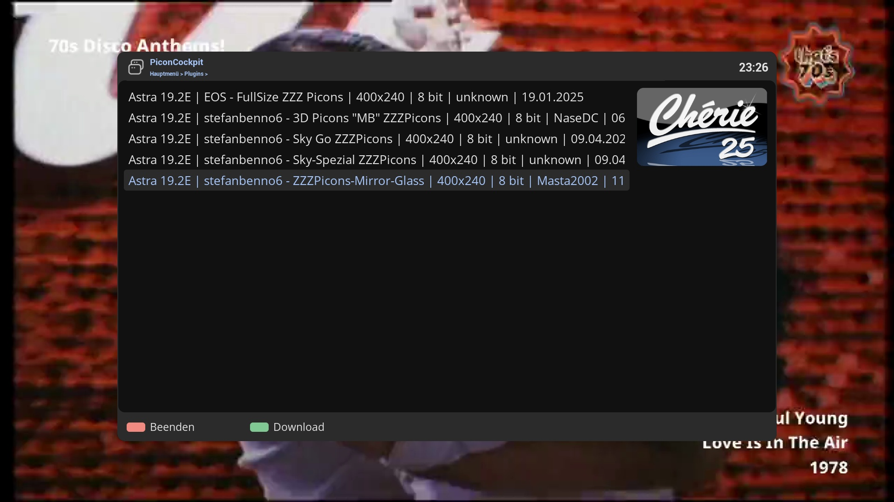

# PiconCockpit (PIC)

## Features
PiconCockpit is a plugin for Open Enigma2 receivers that downloads picons from a picon server.

## Documentation
Installation, usage, the settings and troubleshooting are described in the [PiconCockpit wiki](https://github.com/OpenCockpit/PiconCockpit/wiki).

## Limitations
- Tested on OpenViX and OpenATV with DM900.

## Installation
- https://OpenCockpit.github.io/PiconCockpit

## Wiki
- https://github.com/OpenCockpit/PiconCockpit/wiki
